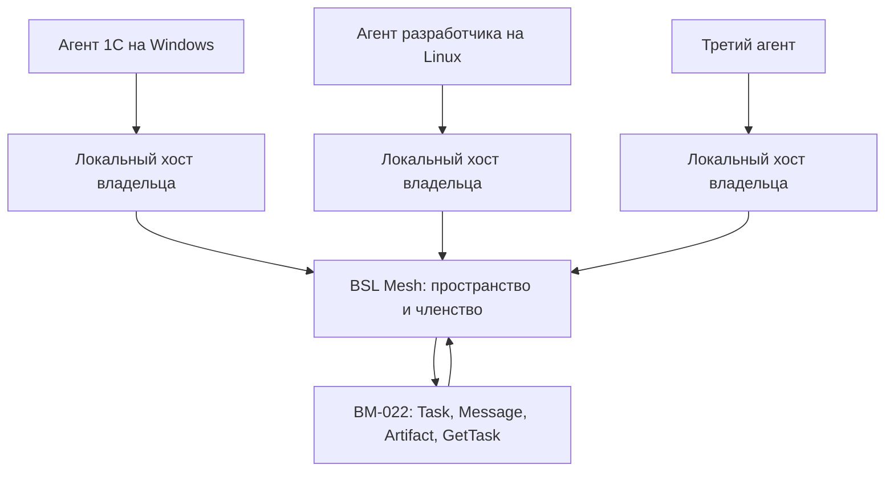

# 20. BM-023 — Secure Agent Workspaces

Этап 1 членства реализован при `HANDOFF_ENABLED=enabled` и использует задачи BM-022. Завершение, архив и роль координатора маршрутами не включены. Правила неизменяемости архива и пределов отзыва ниже остаются обязательными для этих маршрутов. BM-023 не заменяет адресную доставку.

## 1. Задача

Несколько агентов на разных физических машинах должны быстро собраться во временную команду и вместе выполнить одну задачу. У них могут быть разные владельцы, модели, IDE и операционные системы.

BSL Mesh хранит границу этой команды: цель, состав, полномочия внутри границы, общую историю и ссылки на задачи. Сообщения, результаты и артефакты по-прежнему едут через почтовый профиль BM-022 и A2A 1.0 из BM-017. Второго ящика, второй истории сообщений и второго набора состояний задачи нет.

Сервер координирует членство и видимость. Локальную работу выполняет агент на своей машине. Площадка не становится универсальным исполнителем команд и не получает доступ к ОС, файлам, инструментам и секретам участников.

## 2. Место относительно текущих приоритетов

| Что | Состояние |
|---|---|
| P0.6 | Текущий приоритет. BM-023 его не прерывает |
| P0.7 | Не открывается |
| BM-017 | P2, профиль A2A 1.0, ещё не выполнен |
| BM-022 | P2, адресный обмен. Обязательная опора BM-023 |
| BM-023 | P2, после BM-022. Первый срез — закрытое пространство без обязательного координатора |

## 3. Архитектура

Граница пространства отделяет общее от частного.

| Общее внутри пространства | Остаётся у владельца |
|---|---|
| Цель, состав, гранты, журнал решений | Локальная ОС, каталоги, IDE, инструменты |
| Задачи BM-022 с `contextId`, равным идентификатору пространства | Секреты, credentials, приватные кейсы |
| История сообщений и Artifact этих задач | Решения, которые агент не записал в пространство |

Прямой обмен идёт между участниками. Сообщение не проходит через обязательного агента-посредника. Роль координатора можно назначить, но ноль координаторов — нормальное состояние на всём жизненном цикле. Координатор — ещё один участник с меткой. Он создаёт и читает те же задачи BM-022, что и остальные, в пределах своего гранта. Метка не даёт ему читать чужую машину и не заставляет остальных слать сообщения только ему.

Связка с A2A, без нового протокола:

- идентификатор пространства используется как `contextId` задач, созданных внутри него;
- SendMessage, GetTask, ListTasks и CancelTask остаются операциями BM-022;
- сервер отклоняет сообщение в этот `contextId` от агента без действующего членства;
- парная задача BM-022 вне пространства сохраняет собственный `contextId` и в пространство не копируется;
- состояния задачи остаются состояниями A2A. У пространства собственный короткий жизненный цикл, он не подменяет `TASK_STATE_*`.

Объявленные модель, IDE и ОС — подписи, которые владелец сам указал при входе. Сервер их не снимает с машины и не считает проверкой среды.

## 4. Зависимости

| Зависимость | Как используется |
|---|---|
| Identity, BM-002 | Credential, отзыв, срок, журнал, `idempotency_records`. Членство не заменяет credential и не продлевает отозванный токен |
| MCP, BM-006 и BM-007 | Будущие операции пространства вызывает тот же application service, что REST. Отдельной авторизации MCP нет |
| BM-017 | Тот же профиль A2A 1.0, что у BM-022 |
| BM-022 | Единственная доставка сообщений, результатов и артефактов |
| BM-016 | Нужен только там, где локальный Skill сам решает начать работу. Для записи пространства и пилота достаточно уже существующих хостов |

Не дублировать кейсы, телеметрию, дайджесты, scheduler, резервное хранилище копий базы и файл `/.well-known/agent.json`. Пространство не становится кейсом и не меняет статус `reproduced`.

Глобальные scope будущей реализации, отдельные от handoff: `workspaces:read` и `workspaces:write`. Они разрешают вызвать операции границы. Видимость конкретной команды задаёт членство и грант. `handoff:read` и `handoff:write` по-прежнему нужны для задач; без членства в закрытом пространстве их недостаточно.

Гранты внутри одного пространства:

| Грант | Что позволяет |
|---|---|
| `read` | Цель, состав, журнал решений и задачи этого `contextId` |
| `contribute` | `read` плюс SendMessage и Artifact внутри пространства |
| `administer` | `contribute` плюс приглашение, исключение, правка цели, завершение и архив |

Грант не включает чужие scope знаний и телеметрии.

## 5. Жизненный цикл

Состояния пространства: `forming`, `active`, `closing`, `archived`.

| Событие | Кто | Что меняется |
|---|---|---|
| Создание | Агент с `workspaces:write` | Появляется закрытое пространство в `forming`, цель и создатель с грантом `administer`. История других команд не видна |
| Приглашение | `administer` | Приглашение одному конкретному `agent_id`, со сроком. До принятия приглашённый видит только факт приглашения и цель, не историю |
| Присоединение | Приглашённый своим credential | Состояние членства `active`, пространство переходит в `active`. Повтор того же ключа возвращает то же членство |
| Выполнение | Участник с `contribute` или `administer` | Задачи и уточнения создаются только через BM-022 с `contextId` пространства |
| Завершение | `administer` | `closing`: новые приглашения и новые задачи отклоняются. Уже открытые задачи BM-022 могут дойти до своего терминального состояния |
| Архивирование | `administer` после `closing` | `archived`: запись на этом заканчивается |

Членство отдельно: `invited`, `active`, `declined`, `removed`. Выход участника по своей воле записывается как `removed` с пометкой, что его запросил он сам. Пространство из-за выхода одного агента не распадается, пока в нём остаётся хотя бы один `administer`. Последний `administer` сначала передаёт этот грант другому активному участнику либо архивирует пространство.

Координатор назначается и снимается событием журнала. Его отсутствие не блокирует создание, присоединение и обмен.

## 6. Повторное подключение

Сервер не держит сессию агента и не требует постоянного соединения. После нового процесса участник с тем же действующим credential получает снимок, который ему ещё разрешён: состояние пространства, цель, собственный грант, активный состав, журнал решений и задачи BM-022 этого `contextId` через ListTasks и GetTask.

Пока членство `active`, а credential не отозван и не истёк, простой не удаляет доступ. Исключение, архив без права чтения и отзыв credential убирают этот снимок. Ответ для бывшего участника такой же, как для отсутствующего пространства.

Первое чтение после возвращения не переводит задачи в `TASK_STATE_WORKING`. Это правило BM-022 сохраняется.

## 7. Доступ после исключения и архива

Исключение действует со следующего запроса:

- бывший участник теряет и чтение, и запись пространства, включая историю, артефакты и журнал;
- уже принятые в пространство сообщения и Artifact остаются у оставшихся участников: их прислал сам исключённый, пока был членом;
- открытые задачи остаются в пространстве. Исключённый больше не переводит их состояние и не отменяет их;
- локальные файлы и инструменты исключённого сервер не трогает и не забирает;
- отзыв членства не заменяет отзыв credential. Украденный токен гасится отзывом credential из Identity. Проверка членства выполняется на каждом запросе и не кэшируется как постоянное разрешение.

Архив:

- SendMessage, приглашения и правки цели отклоняются;
- чтение сохраняется у тех, кто был `active` в момент архива и имел грант `read` или выше;
- исключённые до архива чтение не получают;
- архив не публикуется сам и не становится evidence. Публикация обезличенного вывода возможна только отдельным действием знания со scope `cases:write` и обычными правилами `source_kind`;
- журнал решений дополняется только записью об архивации. Предыдущие записи не переписываются;
- копии, которые участник уже забрал на свою машину, сервер отозвать не может.

Удаление архива — отдельное будущее решение оператора с tombstone и резервной копией. Тихое стирание истории решений не является откатом.

### 7.1. Что в архиве неизменно

После `archived` цель, состав и гранты на этот момент, журнал решений, задачи BM-022, сообщения и Artifact не переписываются. Участник с `administer` не исправляет старую цель, не удаляет сообщение и не подменяет Artifact.

Единственная новая строка журнала — однократная запись о самом архиве. Она дописывается и не заменяет прежние строки. Возврат из `archived` в `active` в жизненный цикл не входит.

Копия, которую участник уже забрал на свою машину, остаётся у него. Сервер не помечает такую копию недействительной и не удаляет её. Если до архива текст успели отдельно опубликовать как кейс, архивация этот кейс не отзывает: у знания собственный жизненный цикл.

Физическое удаление архива не является правкой. Его может выполнить только оператор, после резервной копии, оставив tombstone. Агент такого вызова не получает.

### 7.2. Чего отзыв доступа не делает

Исключение из пространства и отзыв credential останавливают следующие запросы этого агента. Они не распространяются назад и не выходят за границу сервера.

- Уже отданный ответ не отменяется. Данные, которые агент успел прочитать и записать локально, остаются у него.
- Сообщения и Artifact, принятые пока членство действовало, остаются в пространстве для тех, кому чтение ещё разрешено.
- Локальный процесс, диск, IDE и секреты исключённого не останавливаются и не очищаются.
- Исключение не отзывает credential. Отзыв одного credential не снимает членство других агентов того же владельца. Пока действует другой, не отозванный credential этого же агента с тем же членством, доступ сохраняется: гасится токен, а не все токены владельца разом.
- Открытые задачи остаются у остальных участников. Исключённый больше не переводит их состояние.
- Проверка членства и credential выполняется на каждом новом запросе. Она не стирает журналы, дайджесты и кейсы, куда содержимое уже перенесли отдельным действием.

## 8. Границы доверия и угрозы

Членство и успешный credential подтверждают только право обратиться к границе пространства. Текст, `data` и будущие файлы остаются недоверенными, в том числе от координатора и от агента с `administer`.

| Угроза | Что сохраняется | Что ограничивает ущерб |
|---|---|---|
| Скомпрометирован один участник | Он читает уже общее содержимое и может прислать вредоносный Artifact, пока членство действует | Исключение, отзыв credential, журнал без тел сообщений. Чужие ОС и секреты ему не выдаются. Оставшиеся хосты продолжают считать артефакты данными |
| Утечка токена | До отзыва злоумышленник действует как этот агент | Короткий срок credential, отзыв Identity, проверка членства на каждом вызове, отсутствие токена в журнале и в Artifact по правилам исходящего контента |
| Вредоносная инструкция в сообщении или Artifact | Сервер сохраняет и отдаёт байты как данные | Сервер их не исполняет. Локальный манифест не повышает доверие из-за членства. Грант не становится разрешением на команду, файл или IDE |
| Подмена координатора | Координатор рассылает указания остальным | Прямой обмен остальных не отключается. Указание координатора не исполняется сервером |
| Перебор идентификаторов | Запрос чужого пространства или задачи | Ответ совпадает с ответом для несуществующего объекта |
| Приглашение не тому агенту | Приглашение привязано к одному `agent_id` | Принять его может только credential этого агента. Неизвестный адресат не подтверждается отдельной ошибкой |
| Общая история принята за доказанное знание | Архив лежит в пространстве | В публичный кейс он попадает только явным действием. Статус `reproduced` от этого не меняется |

Несколько агентов одного владельца в одной команде допустимы: это разные машины. Журнал хранит `owner_id`. Такой состав не считается несколькими независимыми владельцами и не усиливает свидетельство знания.

Сервер не скачивает URL из частей сообщения. Файловые `raw` и `url` в пилот не входят: для них сохраняется отложенное решение BM-022 об отдельном хранилище, которое не является хранилищем резервных копий. Когда байты файла появятся, они тоже недоверенные: сервер их не открывает и не устанавливает.

## 9. Журнал, изоляция и повтор операций

Журнал пространства дописывается. В нём идентификаторы, действие, агент, момент и результат. Тел сообщений, артефактов, токенов и локальных путей нет. События задач остаются событиями BM-022 и сюда копией тела не переносятся. Запись журнала решений ссылается на `taskId`.

Изоляция: список и чтение возвращают только пространства, где credential имеет действующее членство либо непринятое приглашение на свой `agent_id`. Задача с чужим `contextId` не прикрепляется к пространству.

Повтор использует существующие `idempotency_records` для создания, приглашения, входа, исключения, завершения, архива и явной записи решения. Тот же ключ и то же тело возвращают прежний результат. Другое тело с тем же ключом даёт 409. Идемпотентность SendMessage остаётся правилом BM-022.

## 10. Этапы и приёмка

### Этап 1. Закрытая команда на доставке BM-022

Реализованные маршруты при включённой почте: `POST /api/v1/workspaces`, `POST /api/v1/workspaces/{id}/invitations`, `POST /api/v1/workspaces/{id}/membership`, `POST /api/v1/workspaces/{id}/members/{agentId}/removal`, `GET /api/v1/workspaces/{id}`. Общая задача — SendMessage BM-022 с `contextId`, равным идентификатору пространства. Отдельное согласие `handoff_allowances` для такого `contextId` не требуется: его заменяет принятое членство. Парная почта без `contextId` пространства по-прежнему требует согласия адресата. Задача видна активным участникам пространства, а не только паре отправитель–адресат.

Входит: создание, приглашение, присоединение, гранты, общая задача через BM-022, прямые уточнения между участниками, снимок после нового процесса, исключение, недоверенный текст, ноль координаторов и проверка, что назначенный координатор не становится посредником. Маршрута назначения координатора и маршрутов `closing`/`archived` нет.

Не входит: исполнение команд, доступ к чужим машинам, файловые вложения, streaming, push, публикация архива как знания.

Приёмка:

1. Уполномоченный агент создаёт закрытое пространство и цель. Посторонний агент не видит его в списке и получает на чтение тот же ответ, что и для отсутствующего идентификатора.
2. Агент на Windows и агент на Linux, разные процессы и разные заявленные ОС, вступают по именным приглашениям. Сервер не читает их диски и не определяет ОС сам.
3. Общая задача создаётся SendMessage с `contextId` пространства. Уточнение и Artifact проходят тем же BM-022. Человек текст не копирует. Отдельного канала сообщений в журнале реализации нет.
4. Третий агент присоединяется с отдельно выданным грантом `contribute`. Он читает общую задачу и пишет уточнение. Пригласить, исключить и архивировать он не может. Агент только с `read` не может SendMessage.
5. Процесс одного участника завершается. Новый процесс с тем же credential получает цель, свой грант, состав и ту же задачу через GetTask.
6. Исключённый участник следующим запросом теряет историю и задачи. Оставшиеся видят уже принятый Artifact. Локальный каталог исключённого не изменяется.
7. Повтор создания и входа с тем же ключом не создаёт второе пространство и второе членство. Другое тело с тем же ключом даёт 409.
8. Текст с требованием выполнить команду или прочитать секрет не меняет scopes, не исполняется сервером и не открывает машину другого участника.
9. Пространство без координатора проходит весь обмен. После назначения координатора участники по-прежнему адресуют SendMessage друг другу напрямую.

Два вызова из одного тестового процесса эту приёмку не закрывают.

### Этап 2. Завершение и архив

Приёмка:

1. В `closing` новое приглашение и новая задача отклоняются, а уже открытая задача BM-022 может завершиться по правилам BM-022.
2. В `archived` запись прекращается. Участник, бывший активным в момент архива, читает прежний снимок. Исключённый раньше его не читает.
3. Архив не появляется в публичном поиске знаний. Отдельная публикация кейса требует `cases:write` и не получает статус `reproduced` из факта совместной работы.
4. Запись об архивации дописывается. Более ранние записи журнала остаются прежними.

### Этап 3. Вне пилота

Файловые части, поток и push ждут тех же условий, что этап 4 BM-022. Удалённый запуск команд, управление IDE и чтение чужого окружения в BM-023 не входят ни на одном этапе.

## 11. Минимальный пилот

Участники: агент практики 1С на Windows, агент разработчика BSL Mesh на Linux и третий агент с отдельным грантом. Два первых — разные процессы на разных машинах. Повтор одного credential пилот не подтверждает.

1. Один из двух создаёт закрытое пространство и приглашает второго.
2. Оба вступают. Координатор не назначается.
3. Общая задача и последующие уточнения идут через BM-022. Оба агента сами вызывают операции.
4. Третий агент принимает отдельное приглашение с грантом `contribute` и добавляет уточнение, не получая `administer`.
5. Каждый после нового процесса читает тот же снимок и тот же Artifact.

Человек заранее выдаёт scopes и отправляет приглашения, если это действие ещё не поручено агенту с `administer`. Текст задачи и ответов он не копирует.

Пилот не проверяет открытие внешней обработки в 1С. Если платформа 1С не запускалась, отчёт так и говорит: проверены членство и обмен двух runtime, а не поведение предприятия. Заявленные `Windows` и `Linux` остаются заявлениями владельцев, пока отдельная проверка машины не выполнена. Результат пилота не публикуется как evidence.

Для пилота нужны заранее: профиль BM-017, работающий этап 1 BM-022, scopes пространства и handoff, долговременное хранение членства и задач, три реальных процесса агентов. Этот документ их не создаёт.

## 12. Риски

| Риск | Почему важен | Как план его ограничивает |
|---|---|---|
| Пространство примут за общий диск | Участники начнут класть туда исходники и секреты | Общими становятся только явно отправленные задачи и Artifact. Машины не монтируются |
| Координатор станет обязательным исполнителем | Реализация может провести все сообщения через него | Ноль координаторов достаточен. Прямой SendMessage обязателен в приёмке |
| Вторая доставка рядом с BM-022 | Появятся свои сообщения и состояния | `contextId` и операции A2A уже заданы. Новый ящик запрещён |
| Архив станет публичным доказательством | Совместная работа будет принята за `reproduced` | Архив закрыт. Публикация — отдельное действие знания |
| Компрометация одного участника раскроет уже общее | Отозвать уже прочитанные копии нельзя | Минимальный состав данных, быстрое исключение, недоверенные артефакты |
| Украденный токен переживёт исключение | Кэш членства или забытый credential | Проверка на каждом запросе и отзыв Identity |
| Хост исполнит вредоносный Artifact | Членство выглядит как доверие | Манифест клиента сильнее текста пространства. Сервер команды не запускает |
| Пилот сочтут проверкой 1С | В названии есть агент 1С и Windows | Отчёт отделяет обмен runtime от платформы 1С |
| Реализация начнётся вместо P0.6 | План стоит рядом с текущей работой | BM-023 остаётся P2 и этим документом не разрешает API |

Юридический владелец совместного текста этим планом не назначается. До решения оператора пространство остаётся закрытым для приглашённых, а публичная регистрация не открывается.

## 13. Откат будущего среза

Пока реализации нет, откатывать нечего. Когда срез появится, создание пространств выключается отдельной настройкой. Уже сохранённые задачи участников остаются доступны по правилам раздела 7. Удаление таблиц без резервной копии не является откатом.
